<div align="center">



</div>



##  `[ 01 ]` ABOUT

`$ whoami`

I'm an electronics and communication engineer. I like the overlap between the physical and digital sides of a device — circuits and sensors on one side, firmware and software on the other.

Most of what I know comes from personal projects and coursework, and I'm still learning as I go. This profile is where I keep track of the things I've built along the way.


##  `[ 02 ]` PROJECTS

`$ ls ~/projects`

<table>
<tr>
<td width="50%" valign="top">

### <code>MOD.01</code> HomeCore

An Android app for switching ESP-based relay modules over a local network.

<code>kotlin</code> <code>esp32</code>

[<code>open_repo ↗</code>](https://github.com/adithya-s-119/HomeCore)

</td>
<td width="50%" valign="top">

### <code>MOD.02</code> PDF Color Inverter

A Windows utility for converting PDFs to a dark colour scheme, with batch processing and English/Malayalam OCR.

<code>python</code> <code>ocr</code>

[<code>open_repo ↗</code>](https://github.com/adithya-s-119/PDF-Color-Inverter)

</td>
</tr>
<tr>
<td width="50%" valign="top">

### <code>MOD.03</code> Spicetify Manager

A small Windows GUI for installing, backing up, and updating spicetify.

<code>c#</code> <code>winforms</code>

[<code>open_repo ↗</code>](https://github.com/adithya-s-119/spicetify-manager)

</td>
<td width="50%" valign="top">

### <code>MOD.04</code> Arduino Geiger Counter

An Arduino Uno Geiger counter that counts pulses from a Geiger–Müller tube and displays readings on an OLED.

<code>c</code> <code>arduino</code>

[<code>open_repo ↗</code>](https://github.com/adithya-s-119/Arduino-Based-Geiger-Counter)

</td>
</tr>
</table>


##  `[ 03 ]` TOOLCHAIN

`$ toolchain --list`

```text
┌─[ TOOLCHAIN ]──────────────────────────────────────────────────┐
│ langs     c / c++ / python / kotlin / java / matlab / verilog  │
│ hardware  esp32 / arduino / kicad / easyeda                    │
│ software  android studio / vs code / git / linux               │
└────────────────────────────────────────────────────────────────┘
```




##  `[ 04 ]` UPLINK

<div align="center">

[`github`](https://github.com/adithya-s-119) &nbsp;&nbsp; [`linkedin`](https://www.linkedin.com/in/adithya-s-00471924b) &nbsp;&nbsp; [`website`](https://solo.to/adithya_s)

<br><br>

`> feedback and corrections always welcome.` 

</div>
